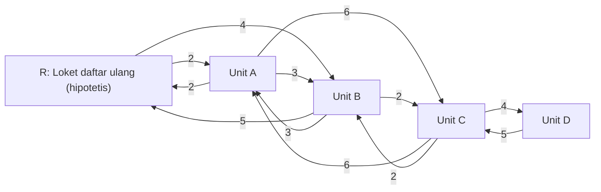

# Smart Queue: catatan desain masa depan

| Butir | Keterangan |
| --- | --- |
| Status | **Desain masa depan saja.** Belum disetujui, belum diimplementasikan |
| Keputusan pemilik | Implementasi smart queue **ditunda** (owner brief 18 Oktober 2026, bagian 11-13) |
| Tanggal | 18 Oktober 2026 |
| Cakupan | Penjadwalan pasien di antara unit pemeriksaan setelah pasien diaktifkan di antrian klinis |
| Bukan cakupan | Kapasitas pendaftaran, pembayaran, penerbitan nomor antrian MCU (lihat bagian 3.3) |
| Kaitan | OD-08, OD-48, OD-49, OD-53 di [OPEN_DECISIONS.md](OPEN_DECISIONS.md); Q12 dan R-08 di [REQUIREMENTS_RESOLUTION.md](REQUIREMENTS_RESOLUTION.md); [SYSTEM_DESIGN.md](SYSTEM_DESIGN.md) §5 "Queue scheduling" |

Dokumen ini adalah bahan tinjauan. Tidak ada rumus, bobot, atau aturan klinis di sini yang menjadi persyaratan. Semua angka contoh bersifat hipotetis dan bukan data RSUD Haji.

## 1. Masalah dan deskripsi kerja

PRD menjanjikan estimasi waktu tunggu dan kondisi antrian terkini (Solusi 6, `docs/Digitalisasi MCU RSUD Haji.md` l.28-29), denah ke ruangan berikutnya (Solusi 7, l.30-31), dan perlakuan khusus layanan berdurasi panjang (Solusi 8, l.32-33). UC10 menyatakan bahwa setelah verifikasi daftar ulang, sistem "memasukkan pasien ke dalam Smart Queue" (l.360). PRD tidak menjelaskan cara sistem memilih unit berikutnya atau urutan panggil.

Tujuan yang disampaikan pemilik:

1. mengurangi waktu tunggu pasien;
2. mengurangi waktu penyelesaian total MCU per pasien;
3. memakai kapasitas unit secara efektif.

Deskripsi kerja yang dipakai dokumen ini:

> **Dynamic patient scheduling across examination units, with flexible examination order, resource constraints, and travel times.**

Artinya: setiap pasien membawa sekumpulan pemeriksaan yang urutannya tidak tetap (kecuali dibatasi prasyarat klinis), setiap unit adalah sumber daya terbatas, dan perpindahan antarunit memakan waktu. Keputusan diambil berulang sepanjang hari berdasarkan kejadian nyata (masuk, keluar, kedatangan), bukan sekali di awal hari.

"CPU best fit" adalah **analogi** dari pemilik, bukan algoritma yang lengkap. Analogi ini menangkap gagasan "tempatkan pekerjaan pada sumber daya yang paling cocok", tetapi tidak menjawab keadilan antarpasien, prasyarat klinis, waktu tempuh, ketidakpastian durasi, atau risiko pasien dengan pemeriksaan panjang terus tertunda. SYSTEM_DESIGN §5 (l.136) sudah mencatat hal yang sama: "'Best fit' alone is not a complete policy".

## 2. Hubungan dengan desain yang sudah ada

SYSTEM_DESIGN §5 "Queue scheduling" (l.134-138) sudah mengusulkan: modul kebijakan di backend, batasan keras terlebih dahulu lalu pemeringkatan, urutan kedatangan sebagai tie-breaker, override petugas yang diaudit, tidak ada aturan lab dua jam sebelum RS menetapkannya, dan simulasi sebelum routing otomatis. Dokumen ini memperinci usulan tersebut dan **tidak menggantikannya**. Dua catatan:

- SYSTEM_DESIGN menyebut "multiple rooms/servers" per unit, sedangkan masukan pemilik menyebut kapasitas satu pasien per unit pada satu waktu. Bila satu unit ternyata punya beberapa ruangan, cara yang konsisten adalah memodelkan setiap ruangan sebagai sumber daya berkapasitas satu. Ini perlu dikonfirmasi RS (bagian 9).
- Modul kebijakan, transaksi penugasan, dan endpoint di SYSTEM_DESIGN tetap usulan. Pemilik menunda seluruh implementasinya.

## 3. Yang ada saat ini (bukti)

### 3.1 Data kunjungan contoh

`frontend/src/lib/mock-records.ts`:

- l.84: `Visit = { queue, unit, queuedAt, inAt?, outAt? }`. Satu baris adalah satu kunjungan pasien ke satu unit.
- l.85: status turunan hanya tiga, `Menunggu` (belum `inAt`), `Diperiksa` (ada `inAt`), `Selesai` (ada `outAt`).
- l.87-101: 13 kunjungan contoh di tiga unit (`lab`, `eye`, `ent`) dengan jam contoh pada `SAMPLE_TODAY` (16 Oktober 2026).
- l.107-112: metrik per kunjungan. `waitMinutes` = `queuedAt` ke `inAt`; `examMinutes` = `inAt` ke `outAt`; `tatMinutes` = `queuedAt` ke `outAt`. Komentar l.107 menyatakan definisi ini bergantung pada UC19.

Pengamatan yang relevan untuk smart queue:

- Tidak ada status "dalam perjalanan", tidak ada lokasi, tidak ada waktu tempuh, tidak ada prasyarat.
- `queuedAt` di unit berikutnya hampir sama dengan `outAt` di unit sebelumnya (contoh: nomor `001` keluar lab 08.01, `queuedAt` mata 08.02; nomor `003` keluar lab 08.12, `queuedAt` mata 08.13). Akibatnya waktu tempuh, bila ada, tercampur ke dalam `waitMinutes`.
- `tatMinutes` adalah TAT per kunjungan unit, bukan waktu penyelesaian total per pasien.
- Urutan kunjungan per pasien di data contoh adalah karangan mockup, bukan hasil algoritma.

### 3.2 Layar antrian unit (UC19, UC20) dan turunannya

- `frontend/src/components/roles/unit-queue.tsx`: komponen bersama untuk `/unit-staff/queue` (`unit-staff-queue.tsx`, `canMove`) dan `/unit-doctor/queue` (`unit-doctor-queue.tsx`, hanya lihat).
  - l.12: baris diambil dari data contoh unit `MY_UNIT` dan disimpan di state browser saja.
  - l.26: tombol "Masuk" nonaktif selama ada pasien yang sedang dilayani. Ini sudah mencerminkan kapasitas satu di tingkat tampilan.
  - l.26-27: petugas boleh menekan "Masuk" pada nomor menunggu mana pun; tidak ada urutan sistem (OD-53).
  - l.38-41: "Keluar" mencatat `outAt` dari jam browser.
  - l.46: teks "Urutan antrian klinis menunggu keputusan (Q12)".
- `frontend/src/components/roles/staff-worklist.tsx` (UC09): hitungan Menunggu/Diperiksa/Selesai dan rata-rata dari data contoh; l.9 menyatakan tidak ada estimasi.
- `frontend/src/components/roles/management-reports.tsx` (UC23, UC24): rata-rata tunggu dan rata-rata TAT per unit (l.20-21, l.39-40).
- `frontend/src/components/patient.tsx` l.43-44: tombol "Hitung estimasi waktu tunggu" menampilkan `--:-- WIB` dan "Perhitungan estimasi belum tersedia". Arti estimasi masih terbuka (OD-48).
- Desain basis data: `examination` (`pending → ready → assigned → in_service → completed`), `queue_assignment` (`waiting → called → in_service → finished`, satu penugasan aktif per kunjungan), `examination_event` (DATABASE_DESIGN.md l.18, l.33-35). Hasil dan verifikasinya adalah entitas terpisah (`result_revision`, `result_verification`). Belum ada keadaan "dalam perjalanan" dan belum ada data lokasi atau waktu tempuh.

### 3.3 FIFO registrasi dan mengapa tidak menyelesaikan penjadwalan klinis

- `backend/app/registration.py` (l.1, l.43, l.58-59): sesi registrasi FIFO menurut `sequence`, dengan 100 tempat aktif dan 50 tempat tunggu. `frontend/src/components/registration.tsx` l.129: "Posisi tunggu sesi registrasi bukan nomor antrian MCU".
- Owner brief §4 memisahkan lima hal yang tidak boleh berbagi penghitung: A akses registrasi, B inventaris yang ditahan saat menunggu pembayaran, C inventaris terkonfirmasi, D antrian tunggu 50 orang, dan **E antrian pemeriksaan klinis**. Smart queue hanya menyangkut E.
- Owner brief §6: nomor antrian MCU resmi terbit setelah pembayaran admin terverifikasi; aktivasi klinis terjadi setelah daftar ulang dan validasi identitas di lokasi (UC10). Keduanya kejadian terpisah. Smart queue baru berlaku setelah aktivasi klinis. Nomor antrian bukan izin masuk unit.

FIFO registrasi tidak menjawab penjadwalan klinis karena:

1. FIFO registrasi mengatur siapa mendapat tempat layanan pada hari H+1, bukan unit mana yang dikunjungi lebih dulu.
2. Pasien membawa kumpulan pemeriksaan yang berbeda; durasi berbeda per jenis pemeriksaan dan per unit.
3. Urutan kedatangan dan daftar ulang di lokasi tidak sama dengan urutan registrasi.
4. Ada waktu tempuh antarunit dan prasyarat klinis yang tidak dikenal oleh antrian registrasi.
5. Paling jauh, urutan registrasi atau nomor antrian dapat menjadi salah satu kandidat tie-breaker. Itu pun belum diputuskan.

## 4. Model konseptual

| Konsep | Arti dalam model |
| --- | --- |
| Pasien | Sekumpulan tugas pemeriksaan yang wajib diselesaikan dalam satu kunjungan MCU. Pasien hanya dapat berada di satu tempat dan menjalani satu pemeriksaan pada satu waktu |
| Unit (atau ruangan) | Sumber daya terbatas. Masukan pemilik: kapasitas satu pasien pada satu waktu. Punya jam buka, ketersediaan petugas, dan bila diperlukan kehadiran dokter (UC21) |
| Pemeriksaan | Tugas yang membutuhkan waktu di unit yang memenuhi syarat untuk jenis pemeriksaan itu. Durasi bergantung pada jenis pemeriksaan, bukan sama rata per unit |
| Waktu tempuh | Waktu berpindah antara dua lokasi, diambil dari graf konektivitas (bagian 5) |
| Prasyarat klinis | Batasan kelayakan: pemeriksaan X hanya boleh dimulai setelah Y selesai, atau setelah jeda minimum tertentu. Harus disetujui pihak klinis RS |
| Kejadian otoritatif | Masuk dan Keluar yang dikonfirmasi petugas unit (UC19; PRD Batasan 3, l.166: "Update status antrian hanya berjalan setelah konfirmasi petugas secara digital"). Estimasi tidak pernah menggantikan kejadian ini |

Keadaan satu tugas pemeriksaan dipisahkan sebagai berikut. Sebelum keadaan pertama, tugas dapat "belum memenuhi syarat" karena prasyarat belum terpenuhi.

| Keadaan | Arti | Pemicu masuk |
| --- | --- | --- |
| Menunggu (queued) | Tugas sudah ditugaskan ke unit dan pasien sudah tiba atau dianggap tiba di unit | Kedatangan di unit (cara mencatatnya belum diputuskan) |
| Dalam perjalanan (travelling) | Tugas sudah ditugaskan, pasien sedang berpindah ke unit | Penugasan setelah Keluar dari unit sebelumnya atau setelah aktivasi UC10 |
| Diperiksa (in examination) | Pemeriksaan berlangsung | Masuk oleh petugas unit (UC19) |
| Selesai (completed) | Pemeriksaan fisik selesai; pasien bebas ke tugas berikutnya | Keluar oleh petugas unit (UC19) |
| Hasil terverifikasi (result verified) | Hasil unit sudah diinput (UC18) dan diverifikasi dokter unit (UC22) | Verifikasi dokter unit; tidak menahan unit maupun pasien kecuali RS menetapkan prasyarat berbasis hasil |

Status mockup saat ini hanya punya Menunggu, Diperiksa, Selesai, dan "Menunggu" di sana mencampur perjalanan dengan menunggu.

## 5. Konektivitas unit sebagai graf berarah berbobot

- **Simpul**: unit, ruangan, atau lokasi lain yang relevan (misalnya loket daftar ulang).
- **Sisi**: perpindahan yang diizinkan atau masuk akal secara fisik.
- **Bobot**: waktu tempuh dalam menit.
- **Berarah**: waktu A ke B boleh berbeda dari B ke A (tangga, lift, jalur satu arah). Sisi A ke B boleh ada tanpa sisi B ke A.
- **Tidak lengkap**: tidak setiap pasangan terhubung langsung. Waktu tempuh antara dua simpul yang tidak bertetangga adalah lintasan terpendek melalui sisi yang ada.
- Bukan model "satu ke banyak": setiap simpul dapat punya banyak tetangga masuk dan keluar.

Contoh berikut **hipotetis**, bukan denah atau data RSUD Haji. Nama simpul sengaja abstrak.



Dalam contoh ini R ke C tidak punya sisi langsung; lintasan terpendek R→B→C = 6 menit, lebih cepat dari R→A→C = 8 menit. R ke B (4) dan B ke R (5) tidak simetris.

## 6. Terminologi

| Istilah | Definisi kerja | Catatan |
| --- | --- | --- |
| Travel time (waktu tempuh) | Waktu berpindah dari satu lokasi ke lokasi lain; bobot sisi graf | Bukan bagian dari waktu tunggu |
| Waiting time (waktu tunggu) | Waktu antara pasien tiba di unit (siap diperiksa) dan Masuk | Mockup `waitMinutes` dihitung dari `queuedAt`; bila `queuedAt` dicatat saat penugasan, angka itu ikut memuat waktu tempuh |
| Examination duration (durasi pemeriksaan) | Masuk sampai Keluar yang dikonfirmasi petugas | Diperkirakan per jenis pemeriksaan; nilai sebenarnya bervariasi |
| Total lead time / completion time (waktu penyelesaian total) | Aktivasi klinis (UC10) sampai Keluar dari pemeriksaan terakhir pasien | Ukuran per pasien; berbeda dari TAT per unit (UC23, `tatMinutes`) |
| Waktu verifikasi hasil | Keluar sampai hasil unit terverifikasi (UC22) | Bukan bagian dari waktu penyelesaian fisik |
| Idle time unit | Waktu unit buka dan siap tetapi tidak melayani pasien | Dipakai untuk utilisasi |

## 7. Batasan keras dan dua jenis keputusan

Batasan keras (dari owner brief §12, ditambah prasyarat aktivasi dari SYSTEM_DESIGN §5):

1. Pasien tidak dapat menjalani dua pemeriksaan pada saat yang sama.
2. Unit berkapasitas satu tidak dapat melayani dua pasien pada saat yang sama.
3. Hanya pemeriksaan yang memang wajib bagi pasien itu yang dijadwalkan.
4. Prasyarat dan jeda minimum yang disetujui harus terpenuhi.
5. Unit yang tutup (di luar jam, tanpa petugas, atau tanpa dokter bila diwajibkan) tidak menerima penugasan baru.
6. Penugasan yang sudah ada diperhitungkan; keputusan baru tidak mengabaikan pasien yang sudah ditugaskan atau sedang dalam perjalanan.
7. Selesai pemeriksaan dan hasil terverifikasi adalah dua kejadian berbeda.
8. Tidak ada jeda lab dua jam yang berlaku umum. Jeda apa pun harus ditetapkan RS per pemeriksaan, termasuk titik acuan dan pemeriksaan yang boleh dilakukan di antaranya.
9. Pemeriksaan yang sedang berlangsung tidak pernah diinterupsi.
10. Tidak ada pengalihan berulang pasien yang sedang dalam perjalanan tanpa kebijakan yang disetujui.
11. Hanya pasien yang sudah diaktifkan setelah daftar ulang (UC10) yang ikut dijadwalkan.

Dua keputusan yang berbeda:

- **Keputusan A (per pasien)**: saat pasien diaktifkan atau baru Keluar dari unit, pemeriksaan dan unit mana yang menjadi tujuan berikutnya?
- **Keputusan B (per unit)**: saat unit kosong (setelah Keluar, atau saat buka), pasien mana yang dipanggil berikutnya dari pasien yang menunggu atau sedang menuju unit itu?

A dan B saling bergantung: A memerlukan perkiraan kapan unit tersedia, dan itu bergantung pada aturan B; B hanya dapat memilih dari pasien yang dikirim oleh A. Kebijakan harus menyatakan keduanya secara eksplisit. FIFO registrasi tidak menjawab A maupun B (bagian 3.3).

## 8. Perhitungan kandidat (penjelasan, bukan aturan)

Untuk pasien `p` di lokasi `L` pada waktu `sekarang`, dan setiap tugas `t` yang layak di unit `u`:

```
perkiraan_tiba(p, u)    = sekarang + waktu_tempuh(L, lokasi(u))      // lintasan terpendek di graf
perkiraan_mulai(p, t, u) = max( perkiraan_tiba(p, u),
                                slot_tersedia(u),                    // sisa pasien yang sedang diperiksa + antrian di depan
                                waktu_paling_awal_prasyarat(p, t) )
perkiraan_selesai       = perkiraan_mulai + durasi(t, u)
```

`slot_tersedia(u)` sendiri bergantung pada aturan B dan pada perkiraan sisa durasi pasien yang sedang diperiksa. Semua nilai adalah perkiraan; yang otoritatif hanya Masuk dan Keluar.

Contoh **hipotetis** memakai graf bagian 5. Pukul 08.00 pasien P baru diaktifkan di R dan wajib menjalani pemeriksaan di Unit A (durasi 10 menit) dan Unit C (durasi 25 menit), tanpa prasyarat. Unit A baru tersedia 08.12, Unit C tersedia 08.05.

| Pilihan berikutnya | Tiba | Mulai | Selesai |
| --- | --- | --- | --- |
| Unit A | 08.02 | max(08.02, 08.12) = 08.12 | 08.22 |
| Unit C | 08.06 | max(08.06, 08.05) = 08.06 | 08.31 |

Aturan "selesai paling awal" memilih Unit A. Tetapi bila slot Unit C pukul 08.05 diambil pasien lain selama 25 menit, P yang tiba dari A pukul 08.28 baru mulai 08.30 (atau lebih lambat) dan selesai sekitar 08.55. Bila P ke C lebih dulu, P selesai di C 08.31, tiba di A 08.37, dan dapat selesai sekitar 08.47 bila A kosong. Pilihan yang terbaik secara lokal belum tentu terbaik untuk pasien itu sendiri, apalagi untuk semua pasien.

Masalah yang harus diperhitungkan sebelum memilih kebijakan:

- **Tidak optimal secara global**: keputusan serakah per langkah tidak memperhitungkan dampak pada pasien lain atau pada langkah berikutnya.
- **Kelaparan (starvation) pemeriksaan panjang**: bila B selalu memilih pasien dengan pemeriksaan terpendek atau selesai paling awal, pasien dengan pemeriksaan panjang (PRD Solusi 8 menyebut EKG pasien wanita dan psikiatri) dapat terus terdorong ke belakang.
- **Keadilan dan aging**: prioritas dapat dinaikkan sesuai lama menunggu sehingga setiap pasien akhirnya dilayani. Besarnya kenaikan dan batas waktu tunggu maksimum harus diputuskan RS.
- **Tie-breaking**: aturan penentu yang deterministik dibutuhkan agar hasil dapat diaudit dan direproduksi, misalnya waktu aktivasi lalu nomor antrian. Pilihannya belum diputuskan.
- **Ketidakpastian**: durasi nyata berbeda dari rata-rata. Estimasi untuk pasien (UC04.1) sebaiknya berupa rentang dan diperbarui pada setiap kejadian Masuk/Keluar.

## 9. Data yang harus disediakan rumah sakit

Status: **dijanjikan pemilik** = pemilik menyatakan RS akan memberikan data ini; **belum ada** = belum diminta secara resmi atau belum ada sumbernya.

| Data | Mengapa dibutuhkan | Sumber / pemilik data | Status |
| --- | --- | --- | --- |
| Jumlah dan nama unit | Simpul graf dan daftar sumber daya | RS (operasional MCU) | Dijanjikan pemilik |
| Kapasitas per unit (satu pasien pada satu waktu) | Batasan keras 2; konfirmasi apakah ada unit dengan beberapa ruangan | RS (operasional MCU) | Dijanjikan pemilik |
| Perkiraan rata-rata durasi pemeriksaan | Perhitungan mulai dan selesai | RS (unit pemeriksaan) | Dijanjikan pemilik |
| Waktu tempuh antarunit | Bobot sisi graf | RS (pengukuran di lokasi) | Dijanjikan pemilik |
| Koneksi antarunit | Sisi graf, termasuk arah | RS (denah dan alur) | Dijanjikan pemilik |
| Pemeriksaan wajib per pasien | Kumpulan tugas per pasien | Paket dan layanan pasien (bergantung katalog, OD-09 ditunda) | Dijanjikan pemilik |
| Durasi per jenis pemeriksaan (bukan rata per unit) | Durasi berbeda dalam satu unit | RS (unit pemeriksaan) | Belum ada |
| Unit yang dapat melakukan tiap pemeriksaan | Kelayakan tugas di unit | RS (operasional MCU) | Belum ada |
| Jam buka dan ketersediaan unit | Batasan keras 5 | RS; kemudian Editor (UC27) | Belum ada |
| Ketersediaan dokter dan petugas | Unit tanpa petugas atau dokter tidak dapat melayani (UC21) | RS (jadwal dinas) | Belum ada |
| Pasien yang sedang diperiksa | Slot tersedia unit | Kejadian Masuk/Keluar UC19 setelah implementasi | Belum ada |
| Pasien yang menunggu dan yang sudah ditugaskan | Batasan keras 6; antrian B | Kejadian sistem setelah implementasi | Belum ada |
| Perkiraan sisa waktu pemeriksaan berjalan | Slot tersedia unit | Turunan dari durasi dan waktu Masuk | Belum ada |
| Prasyarat dan jeda minimum | Batasan keras 4 | Pihak klinis RS (Q12) | Belum ada |
| Aturan prioritas yang disetujui | Keputusan A dan B | Pihak klinis dan manajemen RS | Belum ada |
| Waktu kedatangan dan kesiapan pasien | Titik awal penjadwalan; waktu penyelesaian total | Kejadian aktivasi UC10 | Belum ada |
| Kebijakan no-show dan override | Pasien tidak datang ke unit; panggilan di luar urutan (OD-53) | Operasional MCU | Belum ada |
| Kuota layanan berdurasi panjang | PRD Solusi 8; UC25 | RS (operasional MCU) | Belum ada |
| Data historis durasi dan kedatangan (bila ada) | Simulasi dan uji ketahanan terhadap variasi durasi | RS | Belum ada |

## 10. Keputusan yang dibutuhkan sebelum memilih algoritma

1. **Keadilan**: apa definisinya (misalnya tidak ada pasien yang tertinggal jauh dari urutan aktivasinya)?
2. **Waktu tunggu maksimum**: adakah batas per unit atau per pasien, dan apa yang terjadi bila terlampaui?
3. **Aging**: apakah lama menunggu menaikkan prioritas, dan seberapa cepat?
4. **Tie-breaking**: waktu aktivasi, nomor antrian, atau kriteria lain?
5. **Persetujuan aturan klinis**: siapa yang menetapkan dan menyetujui prasyarat, jeda, dan urutan wajib (Q12 menyebut dokter unit)?
6. **Pencatatan override**: bolehkah petugas memanggil di luar rekomendasi, dan apakah alasan wajib dicatat (OD-53)?
7. **No-show**: berapa lama unit menunggu pasien yang ditugaskan tetapi tidak datang, dan ke mana tugasnya kembali?
8. **Pengalihan saat dalam perjalanan**: apakah penugasan boleh diubah ketika pasien sedang berpindah, dan berapa kali?
9. **Kapasitas unit**: apakah setiap unit benar berkapasitas satu, atau sebagian punya beberapa ruangan?
10. **Isi estimasi untuk pasien**: waktu tunggu di unit saat ini, per unit, atau perkiraan jam selesai MCU (OD-48), dan apakah denah menunjuk unit berikutnya (OD-49)?
11. **Peran rekomendasi**: apakah keluaran sistem hanya rekomendasi yang dikonfirmasi petugas, atau penugasan otomatis?

## 11. Rencana evaluasi dengan simulasi

Evaluasi dilakukan dengan simulasi memakai data RS (bagian 9), sebelum ada keputusan implementasi. Simulasi ini juga belum dikerjakan; alat dan bahasa pemrogramannya belum dipilih.

Skenario masukan: satu hari layanan H+1 dengan pasien terkonfirmasi (paling banyak 100 tempat utama sesuai owner brief §4), daftar pemeriksaan per pasien, waktu aktivasi di loket, graf lokasi, durasi per jenis pemeriksaan, dan jam buka unit. Variasi durasi dibuat dari data historis bila ada, atau dari rentang yang disetujui RS, dengan beberapa kali ulangan.

Keluaran yang dihasilkan untuk setiap kebijakan:

| Keluaran | Isi |
| --- | --- |
| Graf lokasi berbobot | Simpul, sisi berarah, dan waktu tempuh yang dipakai simulasi |
| Gantt per unit | Blok pemeriksaan per pasien di setiap unit dan celah idle |
| Linimasa per pasien | Urutan perjalanan, menunggu, diperiksa, dan selesai untuk setiap pasien |
| Tabel penugasan berikutnya | Untuk setiap keputusan: pasien, unit tujuan, perkiraan tiba, mulai, selesai, dan alasan pemilihan |

Metrik:

| Metrik | Catatan |
| --- | --- |
| Rata-rata waktu tunggu | Menurut definisi bagian 6, tanpa waktu tempuh |
| Waktu tunggu persentil 95 (p95) | Menangkap pasien yang paling dirugikan |
| Waktu penyelesaian total per pasien | Rata-rata dan sebaran |
| Jumlah pasien yang selesai | Dalam jam layanan |
| Utilisasi dan idle time per unit | Bukan tujuan tunggal |
| Kasus starvation | Pasien yang tunggunya melewati batas yang ditetapkan RS |
| Ketahanan | Perubahan metrik ketika durasi nyata menyimpang dari perkiraan |

Kebijakan yang dibandingkan (tanpa memilih salah satu):

1. FIFO per unit menurut waktu kedatangan di unit, dengan pasien memilih unit berikutnya dari daftar tetap (pembanding mendekati praktik manual).
2. Waktu tempuh terpendek ke unit berikutnya yang layak.
3. Selesai paling awal dengan aging dan tie-breaker deterministik.
4. Kebijakan lain yang diusulkan RS atau dokter unit setelah melihat hasil awal.

Hasil simulasi menjadi bahan keputusan pemilik dan RS, bukan keputusan otomatis.

## 12. Non-goals saat ini

- Tidak ada mesin optimasi, solver, atau library penjadwalan.
- Tidak ada layanan scheduler, worker, atau endpoint baru.
- Tidak ada dependency baru di frontend maupun backend.
- Tidak ada perubahan skema basis data atau perilaku mockup karena dokumen ini.
- Tidak ada jeda lab dua jam yang berlaku umum.
- Tidak ada interupsi pemeriksaan yang sedang berlangsung.
- Utilisasi unit bukan satu-satunya tujuan; waktu tunggu, waktu penyelesaian total, dan keadilan ditimbang bersama.
- Tidak ada estimasi waktu yang ditampilkan kepada pasien sebagai janji sebelum model dan datanya disetujui.
